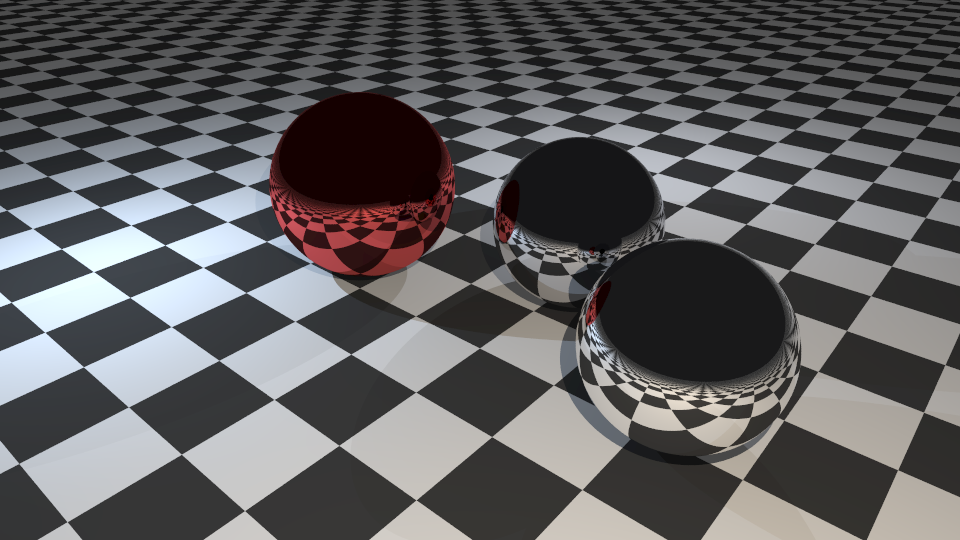

# Pure JS CPU Raytracer

A physically-based 3D rendering engine built from scratch in a single HTML file. No WebGL, no external libraries, no build steps. Pure JavaScript math.

**[Launch the Raytracer](https://koiafk.github.io/cpu-raytracer/)**

## What it does
- **Ray Intersections:** Calculates real-time ray-sphere and ray-plane intersections.
- **Lighting & Shadows:** Implements Lambertian diffuse shading with multiple colored point lights and hard shadows.
- **Reflections:** Recursive ray tracing for perfectly reflective chrome materials (capped by the "Max Bounces" setting).
- **Refractions:** Implements Snell's Law to simulate realistic glass/water spheres.
- **Anti-Aliasing:** Multi-sampling per pixel to smooth out jagged edges.
- **Progressive Rendering:** Uses `requestAnimationFrame` to render the image in chunks, preventing the browser from freezing.
- **Studio UI:** A dark, professional interface with real-time render stats, camera orbiting, and material color pickers.

## How to use
Open `index.html` in any modern browser. 
1. Click and drag on the viewport to orbit the camera around the scene.
2. Use the sidebar to adjust resolution, max bounces, and samples.
3. Click **RENDER** to generate the image.
4. Use `File -> Export PNG` to save your creation.

## Under the hood
The engine runs entirely on the CPU. When you hit "Render" at 960x540, it casts 518,400 primary rays. With 32 bounces and 16 samples per pixel, it calculates over 260 million intersections in a few seconds using pure JavaScript.
